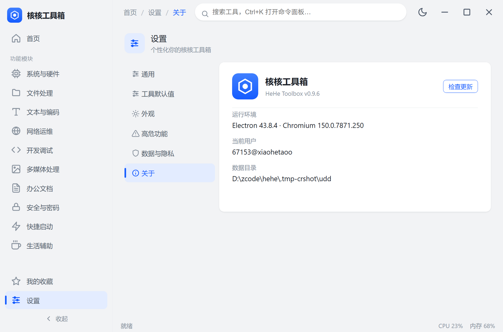

# 核核工具箱软件 V1.0

## 软件说明书

---

## 一、软件概述

### 1.1 软件名称与版本

| 项 | 内容 |
|---|---|
| 软件全称 | 核核工具箱软件 |
| 软件简称 | 核核工具箱 |
| 版本号 | V1.0 |
| 开发完成日期 | 2026 年 11 月 |
| 首次发表日期 | 2026 年 11 月 |
| 开发语言 | JavaScript（ES2020+）/ HTML5 / CSS3 |
| 运行平台 | Microsoft Windows 10 / 11（x64） |
| 软件分类 | 系统工具类应用软件 |

### 1.2 软件简介

核核工具箱软件是一款面向 Windows 桌面用户的**一体化系统工具集合**。它将日常维护电脑时分散在十几个小工具里的需求集中到一个应用内，提供 **111 个独立工具**，覆盖系统与硬件、文件处理、文本编码、网络运维、开发调试、多媒体处理、办公文档、安全密码、快捷启动、生活辅助等十个功能域。

软件采用 Electron 架构，主进程负责系统调用与文件操作，渲染进程负责界面呈现，通过受控的进程间通信（IPC）通道交互。所有高危操作（删除、覆盖、关机重启）均经过独立的安全判定模块校验。

### 1.3 开发目的

Windows 用户在日常维护电脑时，通常需要安装多个来源不明的小工具来完成压缩解压、图片处理、PDF 操作、网络诊断等任务。这些工具存在三个共性问题：**来源不可信**（捆绑广告或恶意代码）、**操作不可逆**（误删后无法恢复）、**体验割裂**（每个工具一套交互习惯）。

本软件的目标是提供一个**来源可信、操作可撤销、交互统一**的替代方案：所有危险操作有前置校验与明确的二次确认，所有长任务可随时中止，界面遵循统一的视觉与交互规范。

---

## 二、运行环境

### 2.1 硬件环境

| 项 | 最低配置 | 推荐配置 |
|---|---|---|
| 处理器 | 双核 1.6 GHz | 四核 2.0 GHz 及以上 |
| 内存 | 4 GB | 8 GB 及以上 |
| 硬盘空间 | 500 MB 可用空间 | 2 GB 可用空间 |
| 显示器 | 1280×720 | 1920×1080 及以上 |

### 2.2 软件环境

| 项 | 要求 |
|---|---|
| 操作系统 | Windows 10（1809 及以上）/ Windows 11，64 位 |
| 运行时 | 已内置（Electron 43 运行时，含 Chromium 140 / Node.js 22） |
| 可选组件 | FFmpeg（多媒体工具首次使用时引导安装）、LibreOffice（Office 与 PDF 互转时优先使用，未安装则走内置渲染） |

**说明**：本软件为绿色免安装版本（Portable），解压后直接运行，不写入系统目录、不修改系统注册表（除用户主动选择的「开机自启」「右键菜单」功能外）。

### 2.3 网络环境

软件核心功能**完全离线可用**。仅在以下场景需要网络：软件更新检查、FFmpeg 组件下载、用户主动发起的网络诊断（Ping、测速、端口测试）、HTTP 请求调试工具。

---

## 三、软件架构

### 3.1 总体结构

软件采用**主进程—渲染进程**分离的双层架构：

```
┌─────────────────────────────────────────────────────┐
│                     渲染进程（界面层）                │
│  index.html + js/（111 个工具页面 + 框架模块）         │
│  ├── js/app.js        页面渲染与保活复用框架          │
│  ├── js/registry.js   工具注册表（导航/搜索/首页）     │
│  ├── js/ui.js         统一 UI 组件库                 │
│  └── js/tools/        48 个工具实现文件（111 个工具）  │
└──────────────────────┬──────────────────────────────┘
                       │ IPC（受控通道，约 300 个）
┌──────────────────────┴──────────────────────────────┐
│                     主进程（系统层）                  │
│  main.js（5414 行）+ ipc/（6 个领域模块）             │
│  ├── lib/channels.js  通道定义（与渲染层镜像同步）      │
│  ├── ipc/fs-ops.js    文件操作（读写/移动/删除/扫描）  │
│  ├── ipc/media-ffmpeg.js  FFmpeg 任务调度            │
│  ├── ipc/env-manager.js  开发环境检测与安装           │
│  └── ipc/dir-acl-links.js  目录搬家与 ACL 处理        │
└─────────────────────────────────────────────────────┘
                       │
┌──────────────────────┴──────────────────────────────┐
│                  公共逻辑层（51 个模块）              │
│  lib/ 目录：纯函数与可注入依赖的设计，全部可单测        │
│  ├── power-gate.js    电源操作门禁                   │
│  ├── path-guard.js    路径安全判定                   │
│  ├── run-token.js     任务生命周期判据                │
│  ├── errors.js        结构化错误码                   │
│  └── ...（共 51 个）                                 │
└─────────────────────────────────────────────────────┘
```

### 3.2 代码规模

| 目录/文件 | 文件数 | 代码行数 | 说明 |
|---|---|---|---|
| `js/` | 66 | 24,844 | 渲染进程：框架 + 111 个工具页面 |
| `lib/` | 51 | 10,735 | 公共逻辑：纯函数模块 |
| `ipc/` | 6 | 5,802 | 主进程领域模块 |
| `css/` | 1 | 1,646 | 统一样式表 |
| `main.js` | 1 | 5,583 | 主进程入口 |
| `preload.js` | 1 | 75 | 预加载脚本（上下文桥） |
| `index.html` | 1 | 197 | 界面骨架 |
| **合计** | **127** | **48,882** | 不含第三方依赖 |

### 3.3 核心技术机制

#### （1）页面保活与生命周期管理

软件采用**页面保活（Keep-Alive）**机制：用户在工具之间切换时，页面 DOM 不销毁，仅隐藏，再次进入时秒开。为解决保活带来的"离开页面后任务继续运行"问题，设计了 `onCleanup` / `onEnter` 双钩子：离开时执行清理（终止任务、退订事件、复位按钮），进入时恢复状态。

#### （2）每次运行令牌（Per-Run Token）

长任务在启动时领取一个自增序号作为「代次令牌」。任务中每个异步等待点返回后，都比对当前令牌与自己持有的令牌是否一致：

- 一致 → 继续执行、更新界面
- 不一致 → 本次运行已过期（用户点了停止，或已离开页面），**终止自己的任务、不触碰界面**

这一机制解决了三个典型缺陷：停止按钮在异步调用返回前无效、切页后旧任务覆盖新界面、多轮任务并发写盘。

#### （3）统一退出码语义

系统命令执行模块默认「非零退出码即失败」，但保留 `allowNonZero` 选项供确实需要读取退出码的调用点使用。例如定时关机需要区分「退出码 1116 = 本来就没有关机计划」与「退出码 5 = 权限不足」，前者对「取消」操作而言就是目标状态。

#### （4）电源操作门禁

所有可能导致关机、重启、休眠的命令在执行前经过 `lib/power-gate.js` 判定。判定不仅识别直接命令，还识别五类绕过路径：

| 绕过方式 | 示例 | 是否拦截 |
|---|---|---|
| 计划任务包装 | `schtasks /create /tr "shutdown /s"` | 拦截 |
| at 命令定时 | `at 23:59 shutdown /s` | 拦截 |
| PowerShell CIM 方法 | `Invoke-CimMethod -MethodName Shutdown` | 拦截 |
| WMI 方法调用 | `(Get-WmiObject ...).Win32Shutdown(2)` | 拦截 |
| 计划任务 API | `New-ScheduledTaskAction -Execute shutdown` | 拦截 |
| **查询类命令** | `schtasks /query`、`shutdown /a` | **放行** |

#### （5）路径安全判定

所有删除与覆盖操作经过 `lib/path-guard.js` 校验，拒绝以下目标：

- 系统关键目录（`C:\Windows`、`C:\Program Files` 等）
- 整个用户主目录及其一级子目录
- **其他用户的主目录深处**（`C:\Users\他人\Documents` 及更深）
- 盘符相对路径（`D:` 会被解析成当前工作目录）
- 设备保留名（`CON`、`PRN`、`AUX`、`NUL` 等）

用户自己的普通目录（如 `Documents\myproject`）正常放行，避免误伤。

---

## 四、功能模块说明

软件共 **111 个工具**，按十个模块组织。

### 4.1 系统与硬件（16 个）

本模块面向日常电脑维护与系统状况排查，用户无需安装第三方检测软件即可了解硬件规格与运行状态。

#### 4.1.1 硬件信息总览

读取并汇总 CPU 型号与核心数、内存容量与频率、主板型号、显卡型号与显存、硬盘型号与容量、网卡型号等硬件规格。数据来源为 WMI 查询与系统 API，不依赖外部工具。

使用场景：新购电脑验机、二手交易核对配置、向技术支持描述机器状况。

关键特性：一次性汇总全部核心硬件，避免在设备管理器中逐项查找；支持一键复制为文本，便于粘贴到工单或聊天窗口。

#### 4.1.2 实时状态监控

以曲线图实时展示 CPU 总占用与各核心占用、内存使用量与可用量、磁盘读写速率、网络上下行速率。采样间隔可调，历史曲线保留最近若干分钟。

使用场景：运行大型程序时观察资源瓶颈、排查"电脑变慢"的具体原因、验证硬件升级效果。

关键特性：曲线为自绘 Canvas 实现，不依赖图表库；采样在渲染进程完成，不占用主进程；长时间打开不会累积内存。

#### 4.1.3 进程管理

列出当前运行的进程，显示进程名、PID、CPU 占用、内存占用、所属用户、启动时间、可执行文件路径。支持按任意列排序、按名称筛选、查看进程详情，并可结束进程。

使用场景：找到吃满 CPU 的异常进程、定位占用内存的可疑程序、关闭无响应的应用。

关键特性：结束进程前有二次确认；对系统关键进程有额外提示；可查看进程的完整命令行，便于识别伪装成正常程序的恶意软件。

#### 4.1.4 开机自启管理

统一管理来自注册表 Run 键、启动文件夹、计划任务三类来源的开机自启项。可查看每一项的名称、命令、来源位置，并可禁用或删除。

使用场景：清理随系统启动的冗余程序、加快开机速度、排查来源不明的自启项。

关键特性：把分散在三处的自启项集中展示，避免用户遗漏；删除前自动备份原注册表值；区分"用户自启"与"系统服务自启"。

#### 4.1.5 磁盘空间分析

扫描指定目录（或整个磁盘），按目录层级汇总体积，以树形列表 + 占比条展示，让用户快速定位占用空间最多的目录与文件。

使用场景：C 盘空间告急时找出空间去向、清理长期未用的大文件、分析项目目录的体积构成。

关键特性：扫描过程可随时停止；支持"仅显示大于指定体积的文件"；扫描结果可导出为文本；对符号链接与硬链接做去重，不会重复计数。

#### 4.1.6 垃圾清理

识别系统临时文件、浏览器缓存、更新残留、回收站、缩略图缓存等可安全清理的内容，按类别展示体积，用户可勾选后一键清理。

使用场景：定期释放磁盘空间、清理系统更新后遗留的安装包。

关键特性：清理前展示每一项的具体路径与体积；默认只勾选确定安全的类别；清理记录可查看，便于确认清理了什么。

#### 4.1.7 系统还原点

列出系统已有的还原点，显示创建时间与描述；支持手动创建新还原点；支持还原到指定时间点。

使用场景：安装大型软件或驱动前创建还原点、系统异常时回退到正常状态。

关键特性：创建还原点前检查系统保护是否启用，未启用时给出开启指引；还原操作有明确的二次确认与影响说明。

#### 4.1.8 空目录清理

递归扫描指定目录下所有不含任何文件的空目录（包括因嵌套而形成的空目录），列出后可批量删除。

使用场景：清理解压后留下的空文件夹、整理项目目录、删除卸载残留的空壳目录。

关键特性：只删除确实为空的目录，遇到任何文件即跳过；支持排除指定名称的目录（如 .git）；删除前完整预览。

#### 4.1.9 系统快捷操作

把常用的系统设置入口集中成一组快捷按钮：控制面板、设备管理器、服务、电源选项、网络连接、系统属性、环境变量、注册表编辑器等。

使用场景：不想在开始菜单里层层查找、需要频繁打开某个系统面板。

关键特性：所有入口一键直达；对需要管理员权限的入口给出提示；可在搜索框按名称快速过滤。

#### 4.1.10 右键菜单管理

列出注册表中登记的右键菜单项（包括文件、文件夹、目录背景三类），显示名称、命令、所属软件，可启用或禁用。

使用场景：清理卸载软件后残留的右键菜单、关闭不需要的菜单项以加快右键响应。

关键特性：区分"文件右键""文件夹右键""目录背景右键"三类作用域；禁用为可逆操作（不删注册表项）；对系统自带菜单项有保护标记。

#### 4.1.11 经典右键菜单

在 Windows 11 上恢复 Windows 10 风格的完整右键菜单，避免"显示更多选项"的二次点击。

使用场景：Windows 11 用户觉得新右键菜单效率低、常用功能被折叠。

关键特性：通过注册表项切换，可一键恢复原状；切换后需要重启资源管理器，工具内置重启按钮；操作前说明影响范围。

#### 4.1.12 窗口管理

列出当前所有可见窗口，显示窗口标题、所属进程、位置与尺寸。支持批量排列（平铺、层叠）、置顶、隐藏、最小化、关闭等操作。

使用场景：多显示器、多窗口场景下的快速整理；需要某个窗口始终保持最前。

关键特性：窗口操作基于 Win32 API，对绝大多数应用有效；隐藏窗口后可在列表中恢复；支持按进程名筛选窗口。

#### 4.1.13 服务与电源

查看系统服务列表（名称、显示名、状态、启动类型），可启动、停止、修改启动类型；同时提供电源计划的查看与切换。

使用场景：排查因服务未启动导致的功能异常、把不常用的服务改为手动以节省资源、切换高性能电源计划。

关键特性：修改服务需要管理员权限，工具会检测并提示；关键服务有保护标记，避免误停；电源计划切换即时生效。

#### 4.1.14 定时任务

支持定时关机、重启、休眠、锁屏、提醒五类操作。可设定在指定时间点执行，或延迟指定分钟数执行。支持取消已设定的任务。

使用场景：下载大文件后定时关机、睡前设定定时锁屏、工作时段结束自动提醒。

关键特性：关机与重启通过系统 shutdown 命令排期，切换页面不影响执行；睡眠与锁屏由主进程维护定时器；取消时区分"系统计划已中止"与"本来就没有计划"两种情况，不会给出错误提示；所有操作受"系统电源操作"开关控制。

#### 4.1.15 磁盘健康

读取硬盘的 SMART 属性，评估健康状态，显示通电时间、启停次数、读写错误率、坏道相关指标等关键参数。

使用场景：老旧硬盘的寿命评估、数据丢失前的预警、二手硬盘检测。

关键特性：对 SSD 与机械硬盘分别解析对应属性；对关键指标给出通俗解释而非只列数值；读取失败时明确说明原因（如需要管理员权限）。

#### 4.1.16 窗口布局

保存当前多个窗口的位置与尺寸为一套布局方案，之后可一键恢复。

使用场景：固定的工作组合（编辑器 + 浏览器 + 终端）每次开机都要手动摆放；不同任务需要不同的窗口布局。

关键特性：可保存多套方案并命名；恢复时按窗口标题与进程匹配；窗口已关闭时跳过并说明。

### 4.2 文件处理（14 个）

本模块覆盖文件的批量改名、格式转换、加密、分割、查找、权限等日常操作，所有涉及删除与覆盖的操作均经过安全判定。

#### 4.2.1 批量重命名

按用户设定的规则批量修改文件名，支持查找替换、添加前后缀、序号递增、原文件名大小写转换、日期插入等规则，可叠加多条规则组合使用。

使用场景：整理照片（按拍摄日期重命名）、影视文件规范命名、去除下载文件的广告后缀。

关键特性：执行前完整预览新旧文件名对照，发现问题可立即调整；自动检测重名冲突并标红提示；两阶段执行（先改为临时名再改为目标名），避免改名过程中的互相覆盖；执行期间禁用重复点击。

#### 4.2.2 批量改后缀

批量修改一组文件的扩展名。

使用场景：把 .jpeg 统一为 .jpg、把下载的 .txt 附件改回正确后缀。

关键特性：执行前显示"原后缀 → 新后缀"对照；与批量重命名共用冲突检测逻辑；对可能影响文件可用性的后缀变更给出提示（如把图片改成文本后缀）。

#### 4.2.3 文件加密解密

使用 AES-256 算法加密单个文件，生成加密后的文件；解密时使用相同口令还原。

使用场景：加密存放身份证照片、合同扫描件等敏感文件；通过网盘或聊天工具传输私密文件。

关键特性：密钥由口令经 PBKDF2 派生，不是直接用口令加密；加密后的文件不含原文件信息；口令错误时明确提示解密失败而非输出乱码；支持批量加密多个文件。

#### 4.2.4 文件分割合并

把大文件切分成若干指定大小的小片，便于分批传输或存入容量受限的介质；之后可按清单合并还原。

使用场景：把超过网盘单文件限制的视频切分、把大文件分批拷贝到 U 盘。

关键特性：按实际写入字节数判断换片时机，不会因磁盘缓存导致分片体积超出预期；生成清单文件记录分片顺序与校验值；合并时校验完整性，缺片时明确指出缺第几片。

#### 4.2.5 重复文件查找

按文件内容哈希查找完全相同的重复文件，可跨多个目录同时查找。

使用场景：整理多个备份盘后产生的重复照片、清理下载目录里重复的安装包。

关键特性：采用"先比体积、再比哈希"的两级筛选，避免对全部文件计算哈希；同名不同内容的文件不会被误判；可选择保留最早修改的一份，其余可批量删除。

#### 4.2.6 压缩解压

支持 zip、7z、tar、gz 等常见归档格式的解压，以及 zip 与 7z 的创建。

使用场景：日常收发压缩包、打包项目目录、解压他人发来的归档。

关键特性：解压前预览归档内容与总体积；对"压缩包炸弹"做体积预估与拦截；解压路径做穿越校验，防止归档内的恶意路径写到目标目录之外；7z 引擎在系统缺少时自动回退到内置实现。

#### 4.2.7 7z 压缩包

面向 7z 格式的专用界面：查看归档内文件树、按需解压部分文件、创建带密码或分卷的 7z 归档。

使用场景：需要密码保护或高压缩比的归档、只从大归档中取个别文件。

关键特性：可只解压选中的文件而非整个归档；创建时可选压缩级别与是否加密；解压进度实时反馈且可中止。

#### 4.2.8 全局文件搜索

按文件名在指定磁盘或目录下快速搜索，支持通配符与正则。

使用场景：忘记文件放在哪里时快速定位、找出所有同名文件。

关键特性：遍历过程可随时停止，已找到的结果不会丢失；结果按路径分组展示；可直接在结果上执行打开所在目录、重命名、删除等操作。

#### 4.2.9 文件内容搜索

在文件的**内容**中搜索关键词，而不仅是文件名。

使用场景：在一堆文档中找提到某个项目名的文件、在代码库里找某个函数的调用位置。

关键特性：按扩展名自动判断是否为文本文件，二进制文件跳过；结果高亮命中行与行号；支持限定文件类型与最大文件体积；搜索过程可随时停止。

#### 4.2.10 文件占用解锁

查出正在占用某个文件（或某目录下文件）的进程，并可结束这些进程以解除占用。

使用场景：删除文件时提示"文件正在被使用"、卸载软件时提示"文件被占用"。

关键特性：通过 Restart Manager 接口查询占用进程，比逐个进程遍历更准确；列出进程名、PID 与可执行文件路径；结束进程前明确提示影响；对系统关键进程（如 lsass.exe、svchost.exe）有保护，不允许结束。

#### 4.2.11 哈希校验

计算文件的 MD5、SHA-1、SHA-256、SHA-512 校验值，支持与预期的校验值比对。

使用场景：核对下载的安装包是否完整、验证文件传输后未被篡改。

关键特性：大文件采用流式读取，不会一次性载入内存；可同时计算多种算法；支持粘贴官方公布的校验值自动比对并给出结论。

#### 4.2.12 目录搬家

把一个目录完整移动到另一个磁盘位置，并在原位置建立符号链接，使原有引用继续有效。

使用场景：把占用 C 盘空间的游戏或软件目录搬到 D 盘而不破坏其运行、把大型项目目录迁移到容量更大的磁盘。

关键特性：移动前做完整预检（目标空间是否充足、是否存在跨卷限制、目录内链接数量）；复制完成后校验文件数量与体积；链接重建失败时可回退；预检与复制两阶段都记录链接清单，避免长路径场景下漏建链接。

#### 4.2.13 权限修复

诊断文件或目录的访问控制列表（ACL），判断当前用户是否具备读取、写入、删除权限，并可在权限异常时尝试修复。

使用场景：文件突然无法打开或删除、从其他电脑拷贝来的文件提示无权限、目录搬家后权限错乱。

关键特性：区分"所有者不是当前用户"与"缺少具体权限"两类问题并分别给出建议；修复前说明将要执行的操作；对系统关键目录拒绝执行修复。

#### 4.2.14 链接体检

检查快捷方式（.lnk）与符号链接（symlink / junction）指向的目标是否仍然存在。

使用场景：清理卸载软件后残留的失效快捷方式、检查目录搬家后链接是否重建成功。

关键特性：递归扫描指定目录；区分"目标不存在"与"目标无权限访问"；可批量删除失效链接；对指向系统目录的链接有额外提示。

### 4.3 文本与编码（15 个）

本模块处理文本的编码转换、格式处理与内容分析，解决中文环境下最常见的乱码与格式问题。

#### 4.3.1 文本编码转换

在 UTF-8、GBK、GB18030、UTF-16、Big5 等常见编码之间转换文本文件，并可修正已经产生的乱码。

使用场景：打开老系统导出的 GBK 文件显示乱码、把文件转为 UTF-8 以便跨平台使用。

关键特性：转换前自动探测原编码并显示探测依据；支持批量转换整个目录；对无法转换的字符明确列出而非静默替换；转换后可选保留或删除原文件。

#### 4.3.2 Unicode 转义互转

在中文文本与 \uXXXX 转义序列之间双向转换，支持 emoji 等增补平面字符。

使用场景：阅读 JSON 中的中文转义、把配置文件里的转义还原为可读中文。

关键特性：正确合并 UTF-16 代理对，emoji 不会被拆成两个乱码字符；解码时对残缺序列（如只有 \u12）保持原样不破坏；普通文本不受影响。

#### 4.3.3 大小写转换

在全部大写、全部小写、首字母大写、驼峰、下划线、连字符等命名风格之间转换。

使用场景：把变量名在 snake_case 与 camelCase 之间切换、统一文件命名风格。

关键特性：正确识别单词边界，不把 URL、HTTP 等缩写拆错；转换结果实时预览。

#### 4.3.4 文本统计

统计字符数（含与不含空格）、中文字数、英文单词数、行数、段落数、字节数，并给出高频词与阅读时长估算。

使用场景：检查文章是否达到字数要求、估算朗读时长。

关键特性：中文按字计数、英文按词计数，分别统计；高频词支持过滤常见停用词。

#### 4.3.5 正则表达式测试

输入正则与测试文本，实时高亮所有匹配结果，显示捕获分组内容。

使用场景：编写或调试正则、验证一条正则能否正确匹配目标格式。

关键特性：支持常用修饰符切换；匹配结果按分组列出；对语法错误给出具体位置提示；内置常用正则示例可一键载入。

#### 4.3.6 JSON 格式化与查看

格式化、压缩、校验 JSON，并以可折叠的树形结构查看。

使用场景：阅读压缩成一行的接口响应、排查 JSON 语法错误。

关键特性：解析失败时指出错误的行号与列号；树形查看支持展开折叠与路径复制；大文件采用虚拟滚动，不卡界面。

#### 4.3.7 Markdown 预览与导出

编辑 Markdown 并实时预览渲染效果，可导出为 HTML 文件或直接打开。

使用场景：编写说明文档、README、笔记。

关键特性：支持标题、列表、表格、代码块、引用等常用语法；导出 HTML 时为自包含单文件，不依赖外部资源；渲染前对 HTML 做净化，防止脚本注入。

#### 4.3.8 CSV 表格处理

查看、编辑、筛选 CSV 文件，支持指定分隔符与编码。

使用场景：处理导出的报表、查看数据文件。

关键特性：自动识别分隔符与编码；大文件采用分页加载；支持按列排序与简单筛选；修改后可另存为新文件，不覆盖原文件。

#### 4.3.9 差异对比

对比两段文本或两个文件的差异，以并排或行内方式高亮显示新增、删除、修改的部分。

使用场景：比较两个版本的配置文件、核对两份文档的改动。

关键特性：采用行级差异算法，修改行内还能标出具体变动的字符；支持忽略空白差异的选项；结果可导出。

#### 4.3.10 便签笔记

轻量的本地笔记功能，支持多则笔记、标题与标签分类、关键词搜索、自动保存。

使用场景：记录临时信息、整理零散想法、保存常用片段。

关键特性：笔记保存在本地，不上传任何服务器；搜索基于本地缓存，笔记较多时输入不卡顿；切换笔记前若有未保存改动会提示确认，避免丢失。

#### 4.3.11 文本朗读（TTS）

把文本转为语音朗读，支持选择音量、语速，可导出为 WAV 文件。

使用场景：听长文、校对文字的通顺度、生成提示音。

关键特性：朗读过程可随时停止，停止立即生效；导出时使用界面设定的音量而非默认值；对超长文本提示分段，避免一次性合成导致卡顿。

#### 4.3.12 繁简转换

在简体中文与繁体中文之间转换。

使用场景：阅读繁体资料、为港澳台用户准备繁体版本。

关键特性：采用词库级转换而非逐字映射，避免"发"与"髮"这类一字多义误转；支持批量转换文本文件。

#### 4.3.13 乱码修复

针对已经变成乱码的文本，尝试多种编码组合还原原文。

使用场景：从旧系统或错误编码的页面复制来的乱码。

关键特性：自动尝试常见编码组合并给出置信度最高的结果；可手动指定编码尝试；无法还原时明确说明而非强行输出。

#### 4.3.14 文本格式清理

去除文本中的多余空行、行首行尾空格、不可见字符、HTML 标签等。

使用场景：整理从网页或 PDF 复制来的文本、清理日志中的冗余空白。

关键特性：可逐项勾选要清理的内容；清理前后对照预览；不改变正常的段落结构。

#### 4.3.15 字符编码查询

查询指定字符的 Unicode 码点、UTF-8 字节序列、HTML 实体与 URL 编码形式。

使用场景：排查特殊字符导致的问题、编写转义规则。

关键特性：支持输入字符或码点双向查询；对增补平面字符正确显示代理对。

### 4.4 网络运维（11 个）

本模块提供网络连通性诊断、测速、设备发现等工具，全部由本机主动发起，不经过任何第三方服务器。

#### 4.4.1 网络测速

测量当前网络的下行与上行速率。

使用场景：验证宽带是否达到套餐标称速度、排查网络变慢。

关键特性：测速过程有明确进度；对服务器无响应的异常情况有硬超时保护，不会无限等待；测试结果包含延迟与抖动。

#### 4.4.2 Ping 检测

向指定主机发送 ICMP 探测包，显示每次往返时延与丢包率。

使用场景：判断目标主机是否可达、初步判断网络延迟情况。

关键特性：支持连续 Ping 与指定次数；结果实时输出；过程可随时停止，停止立即生效；对超时与不可达分别给出说明。

#### 4.4.3 路由追踪

逐跳追踪到目标主机的网络路径，显示每一跳的地址与时延。

使用场景：定位网络在哪一段出现高延迟、判断线路走向。

关键特性：支持最大跳数限制；每跳多次探测取统计值；过程可随时停止。

#### 4.4.4 局域网设备扫描

扫描当前局域网内活跃的设备，列出 IP、MAC 地址、主机名与厂商信息。

使用场景：查看家里或办公室有哪些设备连着网络、排查蹭网。

关键特性：基于 ARP 表与网段探测；可显示设备厂商；扫描过程可停止，离开页面后结果标记作废并自动收尾。

#### 4.4.5 端口检测

检测指定主机的指定端口是否开放。

使用场景：验证服务是否已启动、排查防火墙拦截。

关键特性：支持单个端口与端口范围扫描；区分"端口关闭"与"被防火墙过滤"两种结果；扫描间隔可控，避免对目标造成压力。

#### 4.4.6 HTTP 请求测试

构造并发送 HTTP 请求，查看响应状态码、响应头与响应体。

使用场景：调试接口、验证服务返回是否符合预期。

关键特性：支持常见请求方法、自定义请求头与请求体；响应体支持 JSON 格式化查看；显示请求耗时。

#### 4.4.7 网站证书查询

查询指定 HTTPS 站点的 SSL 证书信息，包括颁发者、有效期、域名列表。

使用场景：判断证书是否即将过期、验证证书是否覆盖当前域名。

关键特性：显示剩余有效天数并对临期证书标红；列出证书覆盖的所有域名。

#### 4.4.8 DNS 查询

查询指定域名的 A、AAAA、CNAME、MX、TXT 等记录。

使用场景：检查域名解析是否正确、排查解析生效问题。

关键特性：支持指定 DNS 服务器；多种记录类型可一次查询；显示 TTL 与解析耗时。

#### 4.4.9 网络连接查看

列出当前系统建立的所有 TCP/UDP 连接，显示本地地址、远程地址、状态、所属进程。

使用场景：查看有哪些程序在联网、排查异常外联。

关键特性：可按进程名筛选；可一键定位到对应进程并可结束；状态分类展示便于快速浏览。

#### 4.4.10 网卡信息

列出所有网络适配器的名称、类型、MAC 地址、IP 地址、子网掩码、网关、DNS 服务器。

使用场景：配置网络时需要查看当前参数、排查 IP 冲突。

关键特性：区分有线、无线、虚拟网卡；支持一键复制为文本。

#### 4.4.11 网络诊断报告

一次性执行 Ping、DNS 解析、路由追踪、端口连通性等多项检查，汇总成一份诊断报告。

使用场景：网络故障时快速收集信息、向技术支持提交完整状况。

关键特性：各项检查串行执行并显示进度；失败项给出可能原因与建议；报告可一键复制。

### 4.5 开发调试（14 个）

本模块面向开发与调试场景，提供编码转换、生成器、格式化等常用小工具。

#### 4.5.1 二维码生成

把文本或 URL 生成二维码图片，可指定尺寸、容错级别与前景背景色。

使用场景：把网址转为二维码便于手机扫描、为文档生成配图。

关键特性：生成过程纯本地，不经过第三方接口；支持导出 PNG；容错级别可调以适应不同打印或显示条件。

#### 4.5.2 二维码识别

从图片中识别二维码内容。

使用场景：识别截图或照片中的二维码、还原已丢失链接的二维码。

关键特性：支持拖入图片与粘贴剪贴板图片；识别失败时说明原因（图片模糊、码不完整）；识别出的链接可直接打开。

#### 4.5.3 计算器

支持四则运算、括号、幂运算、取模、常用数学函数与常量。

使用场景：日常计算、快速验证表达式结果。

关键特性：表达式按优先级正确求值；支持历史记录回溯；常量后跟百分号（如 pi%）正确按取余处理而非报错。

#### 4.5.4 时间戳转换

在 Unix 时间戳（秒/毫秒）与可读时间之间双向转换。

使用场景：解读日志中的时间戳、生成指定时间的戳。

关键特性：自动识别秒与毫秒；显示本地时区与 UTC 两种结果；支持当前时间的实时刷新。

#### 4.5.5 UUID 生成

生成符合规范的 UUID（v4 随机版本）。

使用场景：为数据库记录生成主键、为测试数据生成唯一标识。

关键特性：一次可生成多个；支持批量复制；可切换带连字符与不带连字符两种格式。

#### 4.5.6 颜色格式转换

在 HEX、RGB、HSL、HSV 等颜色表示之间转换。

使用场景：从设计稿取色后转换格式、调整颜色明度。

关键特性：支持输入带透明度的表示；转换结果可一键复制；提供取色器与调色板。

#### 4.5.7 Base64 编解码

对文本或文件进行 Base64 编码与解码。

使用场景：把图片编码为 DataURL、解码接口返回的编码内容。

关键特性：支持文件与文本两种输入；解码时对非法字符给出提示；大文件采用分块处理不卡界面。

#### 4.5.8 URL 编解码

对 URL 进行 percent 编码与解码。

使用场景：处理含中文或特殊字符的链接、调试接口参数。

关键特性：区分整串编码与仅编码参数值；支持 encodeURI 与 encodeURIComponent 两种口径。

#### 4.5.9 JWT 解析

解析 JWT 令牌的头部与载荷内容，显示各字段与过期时间。

使用场景：调试认证流程、查看令牌中包含的信息。

关键特性：只解析不校验签名，界面上有明确提示；自动换算 exp 等时间字段为可读时间；对格式错误的令牌指出问题位置。

#### 4.5.10 转义字符处理

在文本与各种转义形式（JSON 转义、HTML 实体、C 风格转义、URL 编码）之间转换。

使用场景：把一段含引号的中文放进 JSON、还原从日志中复制出的转义文本。

关键特性：支持多种转义体系分别处理；对嵌套转义可多次解码；结果实时预览。

#### 4.5.11 快捷键速查

列出本软件内置的全部快捷键，并说明各功能的作用。

使用场景：快速熟悉软件操作、查找某个功能的快捷键。

关键特性：按功能分组展示；支持搜索过滤；与设置中的自定义快捷键联动。

#### 4.5.12 端口占用查询

查询指定端口被哪个进程占用。

使用场景：启动服务时提示"端口已被占用"、排查端口冲突。

关键特性：显示占用进程的 PID、名称与路径；可直接结束占用进程；支持一次查询多个端口。

#### 4.5.13 环境变量管理

查看、新增、修改、删除用户级与系统级环境变量，特别是 PATH 的逐条管理。

使用场景：配置开发环境、修复 PATH 被误改导致命令找不到。

关键特性：PATH 按条目拆分展示，可单独启用禁用某一条；删除条目前可确认；修改系统级变量需要管理员权限并明确提示；修改前自动备份原值。

#### 4.5.14 本地服务

在本地启动一个轻量 HTTP 静态文件服务，用于预览网页或共享文件。

使用场景：预览前端页面、临时给同事共享文件。

关键特性：可选择监听端口与根目录；显示访问地址（含局域网 IP）；启动有防重入保护，不会重复启动多个实例；停止时释放端口。

### 4.6 多媒体处理（19 个）

本模块基于 FFmpeg 引擎与浏览器 Canvas，提供图片、视频、音频的常见处理能力。所有长任务均支持中途停止。

#### 4.6.1 图片压缩

在尽量保持观感的前提下减小图片体积，支持指定目标体积或质量。

使用场景：压缩手机照片以便发送、把图片压缩到网站上传限制以内。

关键特性：支持批量处理并显示每个文件的压缩前后体积；可选择"达到目标体积即停"或"按固定质量压缩"；压缩后体积反而变大时保留原图并标注；处理过程可停止，已处理的文件保留。

#### 4.6.2 图片批量处理

对一批图片统一执行尺寸调整、格式转换、旋转、添加边框等操作。

使用场景：统一商品图尺寸、把一批 PNG 转为 JPG。

关键特性：规则可叠加；处理前预览首张效果；输出目录可选择；停止后剩余的图片不再处理。

#### 4.6.3 图片拼接

把多张图片按横向或纵向拼接为一张长图。

使用场景：拼接聊天记录截图、制作长图海报。

关键特性：自动对齐宽度或高度；可指定间距与背景色；拼接大图时按需分配画布，不会一次性创建超大画布。

#### 4.6.4 图片加水印

为图片批量添加文字或图片水印。

使用场景：为原创图片添加版权标识、为文档截图添加内部标记。

关键特性：可设置位置、透明度、旋转角度、字体大小；支持平铺水印；预览即时更新。

#### 4.6.5 图片打乱与还原

按置换算法打乱图片像素位置，使内容无法辨认；使用相同密钥可完整还原。

使用场景：分享截图前遮挡敏感信息、在不便使用加密的情况下临时隐藏画面内容。

关键特性：界面上明确说明"视觉混淆不等同于加密"，并引导需要真正保密时使用文件加密功能；三阶段处理（解码、置换、编码），同一张图只解码一次；打乱与还原必须使用相同密钥，密钥错误时输出无法辨认的图而非原图。

#### 4.6.6 相似图片去重

找出内容高度相似但并非完全相同的图片（如同一张图的不同尺寸、不同压缩版本）。

使用场景：整理手机相册中重复保存的图片、清理下载目录中的重复素材。

关键特性：基于感知哈希而非文件哈希，能识别缩放与轻微压缩后的同一图片；结果以缩略图网格展示，便于人工确认；可设置相似度阈值；可选择性删除。

#### 4.6.7 视频压制

重新编码视频以减小体积或统一格式。

使用场景：压缩手机拍摄的大视频、把视频转为兼容性更好的编码。

关键特性：提供预设压缩档位，也可自定义码率与分辨率；处理过程显示进度与预计剩余时间；可随时取消，取消时立即终止编码任务；离开页面自动终止，不会留下后台进程继续占用磁盘写入。

#### 4.6.8 视频裁剪

截取视频的指定时间段。

使用场景：从长视频中截取精彩片段、去除片头片尾。

关键特性：可视化时间轴选择起止点；可选择"重新编码"（精确但慢）或"直接复制流"（快但可能不精确）；处理中可取消。

#### 4.6.9 音频裁剪

截取音频文件的指定时间段。

使用场景：制作手机铃声、截取音乐片段。

关键特性：显示波形便于精确选择；支持淡入淡出；可取消。

#### 4.6.10 视频抽帧

按时间间隔或指定时间点从视频中提取静帧图片。

使用场景：从视频中截取画面做素材、生成视频预览图。

关键特性：可按固定间隔或指定时间点提取；支持选择输出格式与质量；处理中可取消。

#### 4.6.11 格式转换

在常见音视频格式之间转换。

使用场景：把视频转为手机可播放的格式、提取视频中的音频。

关键特性：目标为音频容器时自动禁用无关的视频参数，避免用户调整无效选项；转换进度实时显示；可取消。

#### 4.6.12 音视频信息

读取媒体文件的编码格式、分辨率、帧率、码率、时长、声道等详细信息。

使用场景：确认视频的真实参数、判断文件是否损坏。

关键特性：信息按分组展示；支持批量读取多个文件并对比。

#### 4.6.13 屏幕录制

录制屏幕的指定区域或整个屏幕，可同时录制麦克风与摄像头画中画。

使用场景：录制操作演示、制作教学视频、录制会议。

关键特性：录制期间锁定帧率、音频、区域等设置，避免中途改动导致文件异常；录制中可查看已录制时长；停止后立即释放设备；开始按钮有防重入保护，不会同时启动两个录制。

#### 4.6.14 截图 OCR

识别屏幕截图或图片中的文字，可一键复制识别结果。

使用场景：提取图片中的文字、识别无法复制的界面文本。

关键特性：支持框选截图与导入图片；识别结果按行保留原有排版；可复制全文或逐行复制；识别过程显示进度；识别中防止重复触发。

#### 4.6.15 批量 OCR

对一批图片或 PDF 逐页识别文字，输出为文本文件。

使用场景：把扫描件转为可编辑文本、批量提取图片中的文字。

关键特性：支持指定输出目录与文件命名规则；逐张显示识别进度；可随时停止，已识别部分保留。

#### 4.6.16 图片信息

读取图片的尺寸、格式、色彩模式、DPI 等基本信息。

使用场景：确认图片是否满足印刷或上传要求。

关键特性：支持批量读取；显示文件体积与压缩率。

#### 4.6.17 EXIF 查看

查看照片的 EXIF 元数据，包括拍摄时间、相机型号、光圈快门、GPS 位置等。

使用场景：查看照片的拍摄参数、确认照片是否包含位置信息。

关键特性：按分组展示 EXIF 字段；对含 GPS 信息的照片有隐私提示；可清除 EXIF 后另存，避免分享时泄露位置。

#### 4.6.18 截图标注

对屏幕区域截图并进行标注：箭头、方框、文字、马赛克、序号标记。

使用场景：制作问题说明配图、标注截图中的重点。

关键特性：截图后立即进入标注界面；工具条可调整笔触粗细与颜色；标注后可复制到剪贴板或保存文件。

#### 4.6.19 屏幕标尺

在屏幕上显示可移动的标尺与取色器，测量像素距离并读取颜色值。

使用场景：前端开发时测量间距、从设计稿取色。

关键特性：可横向或纵向放置；支持多种刻度精度；取色显示 HEX 与 RGB 值；可随时关闭。

### 4.7 办公文档（13 个）

本模块处理 PDF 与 Office 文档的常见操作。涉及 PDF 的操作基于 pdf-lib 与 pdfjs-dist 实现，无需安装 Adobe 系列软件。

#### 4.7.1 PDF 合并

把多个 PDF 文件按指定顺序合并为一个。

使用场景：合并扫描的分卷文档、拼接多份报告。

关键特性：可拖拽调整顺序；合并前显示总页数；保留原有页面尺寸与方向。

#### 4.7.2 PDF 拆分

按页数或页范围把 PDF 拆分为多个文件。

使用场景：从合订文档中提取某几页、把长文档按章节拆分。

关键特性：支持按固定页数等分与按自定义页范围拆分；可指定输出命名规则。

#### 4.7.3 PDF 页面管理

对 PDF 的页面执行删除、旋转、重排、插入空白页等操作。

使用场景：去掉文档中的空白页、把横向扫描页旋转为正向。

关键特性：缩略图预览便于操作；支持按页范围批量操作；保存前可确认最终页序。

#### 4.7.4 PDF 水印

为 PDF 添加文字或图片水印。

使用场景：为分发的文档添加来源标识、添加"内部资料"标记。

关键特性：可设置位置、透明度、角度、平铺方式；支持指定页码范围；预览效果后再保存。

#### 4.7.5 PDF 提取文字

从 PDF 中提取文本内容。

使用场景：把不可复制的 PDF 转为可编辑文本、提取合同条款。

关键特性：对扫描型 PDF 提示需要 OCR；保留段落结构；可导出为 txt。

#### 4.7.6 PDF 瘦身

通过重新压缩图片、去除冗余对象来减小 PDF 体积。

使用场景：处理扫描后体积过大的 PDF、满足上传附件大小限制。

关键特性：提供多档压缩级别；显示压缩前后体积对比；压缩后可预览确认清晰度是否可接受。

#### 4.7.7 PDF 加密与解密

为 PDF 设置打开密码，或移除已知的密码。

使用场景：保护含敏感信息的 PDF、移除本人文档的密码以便自动化处理。

关键特性：明确说明加密强度与使用限制；解密需要正确密码。

#### 4.7.8 PDF 转图片

把 PDF 的每一页导出为图片。

使用场景：把 PDF 转为图片便于分享给不支持 PDF 的场景、生成预览图。

关键特性：可指定 DPI 与图片格式；大文档分页处理并显示进度；可取消，已导出页面保留。

#### 4.7.9 图片转 PDF

把多张图片合成为 PDF。

使用场景：把扫描的照片整理成 PDF、把截图汇总成文档。

关键特性：支持调整顺序与页面尺寸适配；可设置图片边距与是否自动旋转。

#### 4.7.10 Word 转 PDF

把 Word 文档转换为 PDF。

使用场景：对外发布时固定排版、避免对方环境中字体缺失导致版式错乱。

关键特性：优先调用系统已安装的 LibreOffice 进行转换；未安装时明确提示并给出替代方案，不做劣质转换。

#### 4.7.11 PDF 转 Word

把 PDF 内容转为可编辑的 Word 文档。

使用场景：需要在原有文档基础上修改、提取内容重新排版。

关键特性：对排版复杂的文档明确说明还原程度有限；转换失败时给出原因。

#### 4.7.12 Office 格式互转

在 doc、docx、xls、xlsx、ppt、pptx 等格式之间转换。

使用场景：兼容旧版 Office、统一文档格式。

关键特性：依赖系统 LibreOffice；转换前检测可用性；批量转换显示进度。

#### 4.7.13 文档内容提取

从 Office 文档中提取纯文本内容。

使用场景：批量提取报告中的文字用于检索或统计。

关键特性：支持 docx、xlsx、pptx；按文档结构保留段落与表格；可批量处理。

### 4.8 安全与密码（3 个）

本模块提供密码生成、强度评估与剪贴板历史管理。所有数据仅保存在本机。

#### 4.8.1 密码生成器

按指定长度与字符集生成随机密码。

使用场景：为各类网站生成互不相同的强密码。

关键特性：可选择是否包含大写、小写、数字、符号，以及是否排除易混淆字符（如 l 与 1、O 与 0）；基于密码学安全的随机源；生成多个后可一次复制；可显示密码熵值评估强度。

#### 4.8.2 密码强度检测

评估给定密码的强度并给出改进建议。

使用场景：检查自己的密码是否足够强、评估密码策略的效果。

关键特性：综合长度、字符集、常见密码库匹配、重复模式等因素评分；指出具体弱点（如"包含常见词汇"）；不联网、不上传密码。

#### 4.8.3 剪贴板历史

记录最近复制过的文本与图片，支持搜索与重新复制。

使用场景：找回刚才复制过但已被覆盖的内容、在多个内容之间来回粘贴。

关键特性：历史保存在本地；可一键关闭记录；对疑似敏感内容（密码、身份证号格式）做标记；支持按关键词搜索历史；可设置保留条数与自动清理。

### 4.9 快捷启动（2 个）

#### 4.9.1 快捷启动面板

把常用程序、文件、文件夹、网址加入快捷启动列表，通过一组按钮或快捷键快速打开。

使用场景：把每天要用的几个程序集中在一处、快速打开固定项目目录。

关键特性：支持拖入文件或文件夹直接添加；可分组管理与排序；支持为每项设置自定义图标；全局快捷键可唤起面板。

#### 4.9.2 命令收藏

收藏常用的命令行指令，需要时一键执行。

使用场景：保存复杂的 ffmpeg 命令、常用 git 操作、系统维护命令。

关键特性：支持带参数的命令，执行前可编辑；执行结果实时输出；输出内容有行数上限，避免长任务撑爆界面；同一时刻只允许一个命令在执行，防止重复启动；离开页面时终止仍在运行的命令。

### 4.10 生活辅助（4 个）

#### 4.10.1 番茄钟

按番茄工作法计时，工作与休息交替。

使用场景：专注工作时段管理、避免久坐。

关键特性：工作时长与休息时长可自定义；到点提醒；可暂停与跳过。

#### 4.10.2 节假日查询

查询法定节假日与调休安排。

使用场景：安排出行、确认某天是否上班。

关键特性：显示节假日与调休补班日期；支持按年份查询。

#### 4.10.3 日期计算

计算两个日期之间的天数、推算指定天数后的日期、计算工作日天数。

使用场景：计算项目工期、推算合同到期日。

关键特性：支持排除周末与法定节假日的计算；结果同时显示天数与周数。

#### 4.10.4 农历转换

在公历与农历之间转换，显示对应的节气与生肖。

使用场景：查询农历生日对应的公历日期、确认传统节日。

关键特性：支持较长时间范围的转换；同时显示干支纪年。

---

## 五、操作流程

### 5.1 启动与主界面

软件启动后进入主界面。主界面由三部分组成：

**左侧导航栏**：按十个功能域分组列出全部工具，每组可折叠。当前所在的工具项高亮显示。

**顶部工具栏**：包含全局搜索框、命令面板入口（Ctrl+K）、设置入口、关于入口。

**主内容区**：显示当前工具的界面。

**全局搜索**：在顶部搜索框输入关键词（支持中文、拼音首字母、英文），实时筛选匹配的工具。例如输入 "ys" 即可匹配到「压缩解压」「图片压缩」等工具。

**命令面板**：按 Ctrl+K 打开，可直接搜索并跳转到任意工具，也可搜索设置项。

**多标签页**：点击工具时可选择在新标签页打开，便于同时使用多个工具并在其间快速切换。

**深色主题**：在设置中切换浅色与深色主题，切换即时生效且被记住。

### 5.2 通用交互约定

所有工具页面遵循一致的交互规范：

**开始按钮**：位于工具页底部或顶部，点击后启动处理。处理期间按钮进入禁用状态，防止重复触发。

**停止按钮**：长任务工具有独立的停止按钮。点击后立即中止处理，已完成的输出文件保留在磁盘上。停止操作在任务真正开始前也有效——即使任务尚未启动完成，点击停止同样会取消本次操作。

**进度显示**：处理过程中显示进度条与当前文件名，让用户了解进展。

**状态提示**：操作结果以状态行或弹出提示呈现，成功与失败有明确的视觉区分。失败时给具体原因而非笼统的"操作失败"。

**离开页面**：切换到其他页面时，正在运行的长任务会被自动终止，不会在后台继续占用资源。返回该页面时界面恢复到可重新开始的状态。

### 5.3 典型操作流程：批量压缩图片

1. 在左侧导航栏选择「图片压缩」。
2. 点击「添加图片」选择文件，或直接把图片拖入窗口。
3. 在设置区选择压缩方式：按质量压缩或按目标体积压缩。
4. 点击「开始压缩」，界面显示处理进度。
5. 如需中途停止，点击「停止」按钮，已处理的图片保留。
6. 处理完成后，界面列出每张图片的压缩前后体积对比。

**异常处理**：若某张图片压缩后体积反而变大，软件保留原图并在结果中标注「已保留原图」，不会用更大的文件覆盖原文件。

### 5.4 典型操作流程：查找并删除重复文件

1. 选择「重复文件查找」。
2. 添加需要扫描的一个或多个目录。
3. 点击「开始扫描」。软件先按文件体积分组，仅对体积相同的文件计算哈希，减少不必要的计算。
4. 扫描结果按"重复组"展示，每组内列出所有相同文件及其路径、修改时间。
5. 在每组中选择要保留的文件，其余标记为待删除。
6. 核对无误后点击「删除选中」。
7. 删除前弹出确认框，列出将被删除的文件数量与总体积。

### 5.5 安全保护机制

软件对危险操作设置了多层保护：

**第一层：路径安全判定**。删除与覆盖操作执行前，先判断目标路径是否属于系统关键目录（如 Windows、Program Files、用户主目录根）。判定为关键路径时直接拒绝，并说明原因。

**第二层：他人目录识别**。判断目标路径是否位于其他用户的家目录下。属于他人目录时拒绝操作，避免误删其他账户的数据。

**第三层：电源操作门禁**。关机、重启、休眠等高危操作需要用户在设置中显式开启「系统电源操作」开关。门禁不仅能识别直接的关机命令，还能识别通过计划任务、at 命令、WMI 方法、PowerShell Cmdlet 等间接方式发起的关机请求。同时，查询类命令（如查看已有计划任务）不受限制。

**第四层：二次确认**。删除、覆盖、格式化等不可逆操作在执行前弹出确认框，明确列出将被影响的文件数量与路径。

**第五层：可恢复性**。批量操作前生成执行计划，用户可完整预览将要发生的变化再确认；目录搬家等操作在失败时提供回退路径。

## 六、界面展示

软件界面采用统一的视觉规范：

- **色彩**：以蓝色为主色调，深色侧栏 + 浅色工作区
- **字号**：整数刻度（12 / 13 / 14 / 16px），避免亚像素渲染差异
- **圆角**：统一使用 4 / 6 / 8 / 10px 四档
- **间距**：8px 基准网格
- **响应式**：窗口宽度小于 860px 时自动改为上下堆叠布局

主要界面包括：

1. **首页**：模块分类卡片 + 全局搜索框
2. **模块页**：该模块下的工具列表
3. **工具页**：工具的具体操作界面
4. **设置页**：语言、主题、危险操作开关等
5. **关于页**：版本信息与致谢

以下为软件实际运行界面（1440×900 标准窗口，Windows 11）。

### 6.1 首页


**图 1　首页**

首页集中展示十个功能模块入口，每个卡片标注该模块包含的工具数量与功能要点；
顶部提供全局搜索框（支持中文名称、拼音首字母、英文名），可按 `Ctrl K` 唤起命令面板。

---

### 6.2 设置页


**图 2　设置页**

设置页分为「通用 / 工具默认值 / 外观 / 高危功能 / 数据与隐私 / 关于」六组。
图中可见界面语言切换、开机自启、关闭时最小化到托盘、全局唤起热键、
硬件加速视频编码开关等配置项。

---

### 6.3 关于页



**图 3　关于页**

关于页展示软件名称、版本号、运行环境信息与开源组件致谢，并提供检查更新入口。

---

### 6.4 工具页：图片批量处理


**图 4　工具页——图片批量处理**

工具页采用「选择输入 → 设置参数 → 执行 → 查看结果」的统一布局。
该工具支持批量缩放、旋转、格式转换与质量压缩，可一次处理多张图片。

---

### 6.5 工具页：磁盘空间分析


**图 5　工具页——磁盘空间分析**

该工具以树形结构展示各目录占用体积，按大小排序，帮助定位占用空间最多的目录。

---

## 七、技术特点

本章说明软件在工程实现上的核心技术设计。这些机制不是界面功能的简单包装，而是为解决具体工程问题而形成的自有实现。

### 7.1 完整的安全判定体系

#### 7.1.1 路径安全判定的两级结构

软件对"能不能删、能不能覆盖"这类问题采用两级判定。

第一级判断路径是否属于**系统关键目录**。关键目录清单不是写死的字符串列表，而是从系统环境变量（SystemRoot、ProgramFiles 等）动态解析，因此即使用户把系统装在非 C 盘位置，判定仍然正确。

第二级判断路径是否位于**其他用户的家目录**下。这一级容易被忽略：如果只保护系统目录，那么他人账户下的 Documents 等目录会被当作普通目录，一旦误操作就会破坏他人数据。软件通过解析家目录的边界识别出"这属于别人"，从而拒绝递归删除与覆盖。

两级判定分别返回不同的错误码（如 KEY_DIR、OTHER_HOME），界面据此给出针对性提示，而不是笼统的"路径不允许"。

#### 7.1.2 电源操作门禁的多路径识别

软件提供定时关机等功能，这类功能若被滥用会造成数据丢失。因此设置了门禁：只有用户在设置中显式开启「系统电源操作」开关后，相关命令才会被执行。

难点在于**关机命令有多种表达方式**。仅识别 shutdown 这个关键词远远不够，以下写法同样能关掉机器：

- 通过计划任务间接执行：schtasks /create /tr "shutdown /s"
- 通过 at 命令定时执行：at 23:59 shutdown /s
- 通过 WMI 方法：Get-WmiObject Win32_OperatingSystem 的 Win32Shutdown 方法
- 通过 CIM 方法：Invoke-CimMethod -MethodName Shutdown
- 通过计划任务 Cmdlet：New-ScheduledTaskAction -Execute shutdown
- 通过第三方工具：psshutdown -s

门禁通过多个独立判据覆盖上述路径，同时**避免误拦查询类命令**。查看已有的计划任务、结束一个计划、取消已排期的关机都是无害操作，必须放行，否则用户无法检查或撤销自己的计划。

#### 7.1.3 高危操作与恢复操作的区分

取消关机本质上是恢复操作，风险远低于发起关机。软件在判定时区分这两类：发起关机受门禁约束，取消关机不受约束。这样即使用户没有开启电源操作权限，也能取消之前排下的关机计划。

### 7.2 统一的异步任务生命周期管理

#### 7.2.1 问题背景

软件中大量功能是长任务：压缩图片、压制视频、批量 OCR、全盘搜索。这类任务的典型流程是：

1. 用户点击开始
2. 界面调用主进程接口，主进程启动实际工作
3. 任务在后台进行，界面接收进度更新
4. 用户可能中途点击停止，也可能直接切换到别的工具页面

问题出在第 2 步与第 4 步之间：**接口调用是异步的**，从点击开始到拿到任务标识之间存在时间窗口。如果用户在这个窗口内点击停止或切换页面，此时还拿不到任务标识，无法直接终止任务。

早期实现用布尔标记表示"页面已经离开"。但这个方案有根本缺陷：如果用户离开后又返回并重新开始一次任务，布尔标记被重置，**上一次任务的回调**在新一轮运行时仍可能触发，误以为自己是当前任务，从而覆盖界面或重复写文件。

#### 7.2.2 每次运行令牌机制

软件采用**每次运行令牌**替代布尔标记。

每个工具有一个单调递增的序号。每次开始新任务时，序号加一并记下本次的序号值（即令牌）。任务内部每个异步回调在执行前检查：自己持有的令牌是否仍等于当前序号。

- 相等：说明这仍是当前这一轮，正常更新界面。
- 不相等：说明用户已经开始了新一轮或已经离开页面，本次回调属于已过期的上一轮，此时立即退出，不改界面、不写文件，并把自己已启动的任务终止掉。

该机制解决三个具体问题：

**停止发生在任务启动前**。点击停止时序号立即加一，等异步调用返回时令牌已经过期，任务会被自己的回调终止，不会真正开始。

**切换页面后旧任务继续跑**。离开页面时序号加一，旧任务的下一次回调发现令牌过期即自行终止，不会在后台继续占用磁盘与处理器。

**重新进入后两轮任务并发**。新一轮的序号与旧一轮不同，旧一轮的回调会认出自己已过期并退出，不干扰新一轮的界面与结果。

#### 7.2.3 应用于全部长任务

该机制在软件内是统一约定，覆盖图片压缩、图片批量处理、视频压制、视频裁剪、格式转换、批量 OCR、屏幕录制、目录扫描、文件搜索、文本朗读、命令执行等全部长任务。每个工具页还注册页面级清理函数，在离开页面时统一执行"序号加一、终止任务、解除订阅、复位界面"。

### 7.3 原子写替换

#### 7.3.1 问题背景

软件需要下载并替换一些可执行组件。如果直接把下载内容写入目标文件，一旦中断或失败，目标位置就会留下**半截文件**。而后续的功能检测通常只判断"文件是否存在"，于是会认为组件完好，实际每次调用都失败，用户看到的是莫名其妙的转码错误。

#### 7.3.2 解决方式

所有这类替换都采用"临时文件 + 原子重命名"：

1. 把新内容写入同目录下的临时文件
2. 写入完成后校验大小与哈希
3. 校验通过才执行重命名，用临时文件覆盖目标文件
4. 任何一步失败都删除临时文件，目标文件保持原样

重命名在同一磁盘卷内是原子操作，因此不会出现半个文件的中间状态。用户的旧组件要么完整存在，要么被完整替换。

#### 7.3.3 相同思路的其他应用

同样的思路也用于语音导出（先合成到临时文件，成功后才替换目标，避免截断用户原有的同名音频）、配置写入、批量重命名的两阶段执行。

### 7.4 分片与流式处理

#### 7.4.1 大文件分片

文件分割功能需要把大文件切成指定大小的小片。初看只需在写入量达到阈值时切换到下一个文件，但工程上有细节：文件系统的写入返回值反映的是已进入缓冲区的字节数，不一定是已落盘字节数。如果直接用这个值判断换片，在慢盘或杀毒软件扫描时会出现某些分片超出预期大小的情况。

软件改为维护本地计数器，每次写入后按实际写入长度累加，达到阈值才切换，保证分片体积准确。

#### 7.4.2 流式哈希

计算大文件哈希时采用流式读取而非一次性载入内存。处理数 GB 的文件也不会导致内存暴涨，哈希计算与进度更新同步进行。

#### 7.4.3 先比体积再比哈希

重复文件查找与相似图片去重都采用两级筛选：先按体积分组，只有体积相同的才进入下一轮比较。这避免了在文件数量很大时对每个文件都做完整计算。

### 7.5 视觉与交互的一致性设计

#### 7.5.1 设计规范

软件统一以下视觉参数，避免不同工具页面的观感差异：

- **字号**：只使用整数刻度，不使用半像素字号。亚像素字号在不同缩放比例下会让同一行文字的粗细不一致。
- **圆角**：统一为 4、6、8、10 四档，按元素层级递进。
- **间距**：基于 4 的倍数构成的间距体系。
- **颜色**：主色、成功、警告、危险各一套，深色主题下有对应映射。

#### 7.5.2 窄窗口适配

在窗口宽度较小时，三栏布局（左列表、中按钮、右详情）改为上下堆叠，避免每一栏被压得过窄。卡片内边距与表单行距也随宽度收紧。

#### 7.5.3 状态的真实反映

界面状态严格反映实际状态：

- 任务运行中时，开始按钮禁用、停止按钮可用
- 任务结束后，两个按钮都恢复到初始状态
- 离开页面再返回时，界面显示"上一轮已中断"，而不是停留在"正在处理"
- 操作失败时明确说明原因，不显示成功提示

### 7.6 高覆盖率的自动化测试

#### 7.6.1 测试体系

软件配套自研的零依赖测试框架，包含 **217 个测试脚本、2404 条断言**，覆盖：

- 纯逻辑模块的单元测试（路径判定、编码转换、格式解析等）
- 主进程接口的行为测试（用真实处理函数，配合可控伪造依赖，模拟延迟、并发、失败）
- 渲染层的端到端测试（真实启动 Electron，加载页面，执行界面操作并校验结果）
- 源码结构断言（针对难以用行为测试表达的安全约束）

#### 7.6.2 测试的分层设计

测试不是简单的断言数量堆砌，而是按风险分层。

**行为测试优先**。例如"停止按钮在任务启动前点击是否有效"这一条，测试不检查源码里有没有某个变量，而是真实构造一个"接口调用挂起不返回"的场景，在挂起期间点击停止，然后让接口调用返回，最后断言任务没有真正启动、没有遗留后台任务。这类测试能真实复现用户遇到的时序问题。

**源码断言仅用于行为测试无法表达的场景**。例如"是否所有长任务都使用了令牌机制"这类跨多个文件的约定，通过扫描源码结构来校验。

**变异验证**。对关键修复，通过故意注入错误来确认测试确实会失败，避免出现测试通过但没测到问题的假绿。

#### 7.6.3 断言基线

软件维护断言数量基线文件，记录每个测试脚本的断言数量。任何脚本的断言数量低于基线时，测试流程会失败并指出是哪个脚本。这防止了在重构过程中悄悄删掉测试用例、而整体仍显示通过的情况。

---

## 八、第三方组件声明

本软件在自有代码之外使用了以下开源组件，均遵循其各自的开源许可协议。**软件的核心业务逻辑、界面实现、安全判定、任务调度等部分均为自主研发**，第三方组件仅作为基础能力支撑。

| 组件 | 版本 | 许可证 | 用途 |
|---|---|---|---|
| Electron | 43.8.4 | MIT | 桌面应用运行时 |
| 7zip-bin | 5.2.0 | MIT | 7z 压缩引擎 |
| adm-zip | 0.6.1 | MIT | ZIP 格式读写 |
| dompurify | 3.4.17 | Apache-2.0 | HTML 净化（防 XSS） |
| electron-updater | 6.8.11 | MIT | 应用自动更新 |
| jsqr | 1.4.0 | Apache-2.0 | 二维码识别 |
| marked | 12.0.2 | MIT | Markdown 解析 |
| opencc-js | 1.0.5 | Apache-2.0 | 中文简繁转换 |
| pdf-lib | 1.17.1 | MIT | PDF 读写与编辑 |
| pdfjs-dist | 3.11.174 | Apache-2.0 | PDF 渲染与解析 |
| qrcode | 1.5.4 | MIT | 二维码生成 |
| solarlunar | 2.0.7 | MIT | 农历与节气计算 |
| tesseract.js | 7.0.0 | Apache-2.0 | OCR 文字识别 |

**本软件自有代码部分**（48,882 行，127 个文件）的著作权归开发者所有，以 MIT 许可开源。

---

## 九、著作权声明

本软件由开发者独立开发完成，对自有代码部分享有著作权。

软件以 MIT 许可证开源发布，允许他人在保留版权声明与许可声明的前提下自由使用、修改、分发。

---

## 附录 A　工具索引总表

下表列出全部 111 个工具及其所属模块，便于按编号检索。

| 序号 | 模块 | 工具名称 |
|---|---|---|
| 1 | 系统与硬件 | 硬件信息总览 |
| 2 | 系统与硬件 | 实时状态监控 |
| 3 | 系统与硬件 | 进程管理 |
| 4 | 系统与硬件 | 开机自启管理 |
| 5 | 系统与硬件 | 磁盘空间分析 |
| 6 | 系统与硬件 | 垃圾清理 |
| 7 | 系统与硬件 | 系统还原点 |
| 8 | 系统与硬件 | 空目录清理 |
| 9 | 系统与硬件 | 系统快捷操作 |
| 10 | 系统与硬件 | 右键菜单管理 |
| 11 | 系统与硬件 | 经典右键菜单 |
| 12 | 系统与硬件 | 窗口管理 |
| 13 | 系统与硬件 | 服务与电源 |
| 14 | 系统与硬件 | 定时任务 |
| 15 | 系统与硬件 | 磁盘健康 |
| 16 | 系统与硬件 | 窗口布局 |
| 17 | 文件处理 | 批量重命名 |
| 18 | 文件处理 | 批量改后缀 |
| 19 | 文件处理 | 文件加密解密 |
| 20 | 文件处理 | 文件分割合并 |
| 21 | 文件处理 | 重复文件查找 |
| 22 | 文件处理 | 压缩解压 |
| 23 | 文件处理 | 7z 压缩包 |
| 24 | 文件处理 | 全局文件搜索 |
| 25 | 文件处理 | 文件内容搜索 |
| 26 | 文件处理 | 文件占用解锁 |
| 27 | 文件处理 | 哈希校验 |
| 28 | 文件处理 | 目录搬家 |
| 29 | 文件处理 | 权限修复 |
| 30 | 文件处理 | 链接体检 |
| 31 | 文本与编码 | 文本编码转换 |
| 32 | 文本与编码 | Unicode 转义互转 |
| 33 | 文本与编码 | 大小写转换 |
| 34 | 文本与编码 | 文本统计 |
| 35 | 文本与编码 | 正则表达式测试 |
| 36 | 文本与编码 | JSON 格式化 |
| 37 | 文本与编码 | Markdown 预览 |
| 38 | 文本与编码 | CSV 表格处理 |
| 39 | 文本与编码 | 差异对比 |
| 40 | 文本与编码 | 便签笔记 |
| 41 | 文本与编码 | 文本朗读 |
| 42 | 文本与编码 | 繁简转换 |
| 43 | 文本与编码 | 乱码修复 |
| 44 | 文本与编码 | 文本格式清理 |
| 45 | 文本与编码 | 字符编码查询 |
| 46 | 网络运维 | 网络测速 |
| 47 | 网络运维 | Ping 检测 |
| 48 | 网络运维 | 路由追踪 |
| 49 | 网络运维 | 局域网设备扫描 |
| 50 | 网络运维 | 端口检测 |
| 51 | 网络运维 | HTTP 请求测试 |
| 52 | 网络运维 | 网站证书查询 |
| 53 | 网络运维 | DNS 查询 |
| 54 | 网络运维 | 网络连接查看 |
| 55 | 网络运维 | 网卡信息 |
| 56 | 网络运维 | 网络诊断报告 |
| 57 | 开发调试 | 二维码生成 |
| 58 | 开发调试 | 二维码识别 |
| 59 | 开发调试 | 计算器 |
| 60 | 开发调试 | 时间戳转换 |
| 61 | 开发调试 | UUID 生成 |
| 62 | 开发调试 | 颜色格式转换 |
| 63 | 开发调试 | Base64 编解码 |
| 64 | 开发调试 | URL 编解码 |
| 65 | 开发调试 | JWT 解析 |
| 66 | 开发调试 | 转义字符处理 |
| 67 | 开发调试 | 快捷键速查 |
| 68 | 开发调试 | 端口占用查询 |
| 69 | 开发调试 | 环境变量管理 |
| 70 | 开发调试 | 本地服务 |
| 71 | 多媒体处理 | 图片压缩 |
| 72 | 多媒体处理 | 图片批量处理 |
| 73 | 多媒体处理 | 图片拼接 |
| 74 | 多媒体处理 | 图片加水印 |
| 75 | 多媒体处理 | 图片打乱与还原 |
| 76 | 多媒体处理 | 相似图片去重 |
| 77 | 多媒体处理 | 视频压制 |
| 78 | 多媒体处理 | 视频裁剪 |
| 79 | 多媒体处理 | 音频裁剪 |
| 80 | 多媒体处理 | 视频抽帧 |
| 81 | 多媒体处理 | 格式转换 |
| 82 | 多媒体处理 | 音视频信息 |
| 83 | 多媒体处理 | 屏幕录制 |
| 84 | 多媒体处理 | 截图 OCR |
| 85 | 多媒体处理 | 批量 OCR |
| 86 | 多媒体处理 | 图片信息 |
| 87 | 多媒体处理 | EXIF 查看 |
| 88 | 多媒体处理 | 截图标注 |
| 89 | 多媒体处理 | 屏幕标尺 |
| 90 | 办公文档 | PDF 合并 |
| 91 | 办公文档 | PDF 拆分 |
| 92 | 办公文档 | PDF 页面管理 |
| 93 | 办公文档 | PDF 水印 |
| 94 | 办公文档 | PDF 提取文字 |
| 95 | 办公文档 | PDF 瘦身 |
| 96 | 办公文档 | PDF 加密解密 |
| 97 | 办公文档 | PDF 转图片 |
| 98 | 办公文档 | 图片转 PDF |
| 99 | 办公文档 | Word 转 PDF |
| 100 | 办公文档 | PDF 转 Word |
| 101 | 办公文档 | Office 格式互转 |
| 102 | 办公文档 | 文档内容提取 |
| 103 | 安全与密码 | 密码生成器 |
| 104 | 安全与密码 | 密码强度检测 |
| 105 | 安全与密码 | 剪贴板历史 |
| 106 | 快捷启动 | 快捷启动面板 |
| 107 | 快捷启动 | 命令收藏 |
| 108 | 生活辅助 | 番茄钟 |
| 109 | 生活辅助 | 节假日查询 |
| 110 | 生活辅助 | 日期计算 |
| 111 | 生活辅助 | 农历转换 |

**统计**：系统与硬件 16 项、文件处理 14 项、文本与编码 15 项、网络运维 11 项、开发调试 14 项、多媒体处理 19 项、办公文档 13 项、安全与密码 3 项、快捷启动 2 项、生活辅助 4 项，合计 111 项。

---

## 附录 B　快捷键对照表

| 快捷键 | 功能 | 生效范围 |
|---|---|---|
| Ctrl+K | 打开命令面板 | 全局 |
| Ctrl+F | 聚焦搜索框 | 全局 |
| Ctrl+W | 关闭当前标签页 | 多标签模式 |
| Ctrl+Tab | 切换到下一个标签页 | 多标签模式 |
| Ctrl+Shift+Tab | 切换到上一个标签页 | 多标签模式 |
| Esc | 关闭当前弹窗或面板 | 弹窗 / 面板 |
| F5 | 刷新当前工具页面 | 工具页 |
| Ctrl+Shift+V | 打开剪贴板动作面板 | 全局 |
| Ctrl+, | 打开设置 | 全局 |

用户可在设置中为常用工具自定义单个按键的唤起快捷键。

---

## 附录 C　配置与数据存储位置

软件遵循便携式软件的存储约定，用户数据保存在应用目录下的数据文件夹中，不写入系统目录（用户主动开启的自启项与右键菜单除外）。

| 数据类别 | 存放内容 | 说明 |
|---|---|---|
| 用户偏好 | 主题、语言、窗口尺寸、上次打开的工具 | 可在设置中恢复默认 |
| 剪贴板历史 | 最近复制的文本与图片 | 可关闭记录并一键清空 |
| 便签笔记 | 笔记正文与标签 | 纯本地，不上传 |
| 快捷启动项 | 用户添加的程序与文件路径 | 可导出备份 |
| 命令收藏 | 用户保存的命令行 | 可导出备份 |
| 日志 | 运行日志与崩溃记录 | 用于排查问题，不包含用户文件内容 |

**隐私说明**：软件不收集、不上传任何用户数据。所有功能在本机完成，网络访问仅发生在用户主动发起的网络诊断、软件更新检查、组件下载等场景。

---

## 附录 D　异常处理与错误提示规范

软件的错误提示遵循统一规范，便于用户理解问题并采取行动。

### D.1 提示分级

| 级别 | 呈现方式 | 使用场景 |
|---|---|---|
| 成功 | 绿色状态行 + 短暂提示 | 操作正常完成 |
| 警告 | 黄色状态行 | 操作完成但有需注意的情况（如部分文件被跳过） |
| 错误 | 红色状态行 + 详细提示 | 操作失败，需要用户处理 |
| 阻断 | 弹窗 + 明确建议 | 高危操作被安全机制拒绝 |

### D.2 错误信息的三段式

每条错误信息包含三个部分：

1. **发生了什么**：一句话说明失败的操作
2. **为什么失败**：具体原因，而非笼统的"操作失败"
3. **该怎么办**：可执行的建议

例如，删除被拒绝时，提示不是"删除失败"，而是说明"目标位于系统关键目录，无法删除"，并建议"如需清理请使用磁盘空间分析工具查看具体占用"。

### D.3 需要用户注意的典型场景

| 场景 | 软件的处理 |
|---|---|
| 磁盘空间不足 | 提示所需空间与可用空间，建议更换输出目录 |
| 文件被其他程序占用 | 指出占用进程名称，建议关闭该程序或使用文件占用解锁工具 |
| 权限不足 | 提示需要管理员权限，说明如何以管理员身份重新启动 |
| 目标路径位于系统目录 | 直接拒绝并说明原因，不执行任何写操作 |
| 取消操作失败 | 明确说明计划可能仍在生效，给出手动处理方式 |
| 压缩后体积反而变大 | 保留原文件，结果中标注"已保留原图" |
| 组件（如 FFmpeg）缺失 | 提示需要下载，给出自动下载入口 |

---

## 附录 E　版本演进说明

软件开发过程中按功能批次逐步完善，主要阶段如下：

| 阶段 | 主要工作 |
|---|---|
| 初始阶段 | 搭建 Electron 主进程—渲染进程架构，实现基础工具框架与首批工具 |
| 工具扩充阶段 | 按功能域逐步补齐至百项工具，统一界面规范与交互约定 |
| 架构整合阶段 | 抽出通用模块（路径判定、错误处理、任务调度、文件选择等），消除各工具页的重复实现 |
| 安全强化阶段 | 建立路径安全判定、电源操作门禁、高危操作二次确认等安全机制 |
| 取消与生命周期阶段 | 引入每次运行令牌机制，统一解决长任务的停止、切页、并发问题 |
| 测试体系阶段 | 建立零依赖测试框架，覆盖单元、行为、端到端三层，并引入断言基线守卫 |
| 质量收敛阶段 | 多轮代码审查与修复，统一视觉规范，完善错误提示 |

每一阶段完成后都保持功能可用与测试通过，最终形成 V1.0 版本。

---

*说明书结束*
